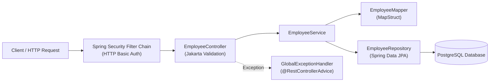

# erp-module-api

RESTful microservice for employee and human resources data management built with Spring Boot, PostgreSQL, and Spring Security.

## System Overview

`erp-module-api` is structured following a layered architectural pattern with clear boundaries between the presentation layer, business service layer, persistence layer, and relational database.



### Architectural Characteristics

- **Separation of Concerns and Immutability**: Domain entities are decoupled from client communication through immutable Java 21 Records (`EmployeeRequestDTO` and `EmployeeResponseDTO`). This prevents over-posting attacks and domain leakage.
- **Compile-time Object Mapping**: Type-safe conversions between entities and DTOs are generated at compile time by MapStruct (`EmployeeMapper`), eliminating reflection overhead.
- **Declarative Input Validation**: Incoming requests are validated at the controller boundary using Jakarta Bean Validation constraints (`@NotBlank`, `@Email`, `@NotNull`, `@PositiveOrZero`).
- **Centralized Exception Handling**: Validation failures and unexpected runtime errors are intercepted by `GlobalExceptionHandler` (`@RestControllerAdvice`). Validation errors produce an HTTP 400 response with a field-to-message mapping, while unhandled exceptions return a normalized HTTP 500 JSON payload.
- **Security Boundary**: The application enforces HTTP Basic authentication via a `SecurityFilterChain` bean. Routes prefixed with `/api/**` require the `ADMIN` role. CSRF protection is disabled for stateless REST interactions.

---

## Technology Stack

| Category | Component / Library | Version | Description |
| :--- | :--- | :--- | :--- |
| Language | Java | 21 (LTS) | Core programming language leveraging modern features (Records, Pattern Matching) |
| Framework | Spring Boot | 3.2.5 | Enterprise web runtime and dependency injection container |
| Web Layer | Spring MVC | 3.2.5 | REST controller dispatching and JSON serialization |
| Security | Spring Security | 3.2.5 | Authentication and authorization filter chain (HTTP Basic) |
| Persistence & ORM | Spring Data JPA / Hibernate | 3.2.5 / 6.4.x | Relational object-relational mapping and repository abstraction |
| Database | PostgreSQL | 18-alpine | Primary relational data store |
| Object Mapping | MapStruct | 1.5.5.Final | Annotation-processor-based compile-time DTO/entity mapper |
| Boilerplate Reducer | Project Lombok | 1.18.36 | Compile-time generation of getters, setters, and constructors |
| Configuration | Dotenv Java | 3.0.2 | Local environment configuration loader |
| Testing | JUnit 5 / Mockito / MockMvc | 3.2.5 | Unit and web-layer slice testing framework |
| Build Tool | Apache Maven | 3.x (mvnw wrapper) | Project build lifecycle and dependency management |

---

## Data Model

The core domain model represents an organization's employee record managed in the `employees` table.

### Relational Schema (`employees`)

| Column Name | Data Type | Constraints | Description |
| :--- | :--- | :--- | :--- |
| `id` | `UUID` | PRIMARY KEY, NOT NULL | Automatically generated UUID identifier |
| `name` | `VARCHAR(255)` | NOT NULL | Full name of the employee |
| `email` | `VARCHAR(255)` | NOT NULL | Corporate email address |
| `department` | `VARCHAR(255)` | NOT NULL | Assigned department or functional unit |
| `salary` | `NUMERIC(38,2)` | NOT NULL | Employee base salary (positive or zero) |

### DTO Contracts

- **`EmployeeRequestDTO`**:
  - `name`: `String` (`@NotBlank(message = "Employee must have a name")`)
  - `email`: `String` (`@NotBlank`, `@Email(message = "Invalid email")`)
  - `department`: `String` (`@NotBlank(message = "Employee must have a department")`)
  - `salary`: `BigDecimal` (`@NotNull(message = "Employee must have a salary")`, `@PositiveOrZero(message = "Salary must be greater than or equal to zero")`)
- **`EmployeeResponseDTO`**:
  - `id`: `UUID`
  - `name`: `String`
  - `email`: `String`
  - `department`: `String`
  - `salary`: `BigDecimal`

---

## API Specification

All application endpoints are served under `/api` and require HTTP Basic authentication.

### Authentication

- **Scheme**: HTTP Basic
- **Default Credentials**: Username `admin`, Password `admin`
- **Header**: `Authorization: Basic YWRtaW46YWRtaW4=`

### Endpoints

#### 1. Register Employee

- **Method**: `POST`
- **Path**: `/api/employees`
- **Headers**:
  - `Content-Type: application/json`
  - `Authorization: Basic <credentials>`
- **Request Body**:
  ```json
  {
    "name": "Jane Doe",
    "email": "jane.doe@example.com",
    "department": "Engineering",
    "salary": 7500.00
  }
  ```
- **Response `200 OK`**:
  ```json
  {
    "id": "e4b1c2a0-4351-4e76-88a2-f8c5b967a5c1",
    "name": "Jane Doe",
    "email": "jane.doe@example.com",
    "department": "Engineering",
    "salary": 7500.00
  }
  ```
- **Error Responses**:
  - `400 Bad Request` (Validation Error):
    ```json
    {
      "name": "Employee must have a name",
      "email": "Invalid email"
    }
    ```
  - `401 Unauthorized`: Missing or invalid credentials.

#### 2. List All Employees

- **Method**: `GET`
- **Path**: `/api/employees`
- **Headers**:
  - `Authorization: Basic <credentials>`
- **Response `200 OK`**:
  ```json
  [
    {
      "id": "e4b1c2a0-4351-4e76-88a2-f8c5b967a5c1",
      "name": "Jane Doe",
      "email": "jane.doe@example.com",
      "department": "Engineering",
      "salary": 7500.00
    }
  ]
  ```
- **Error Responses**:
  - `401 Unauthorized`: Missing or invalid credentials.

---

## Local Setup and Execution

### Prerequisites

- Java Development Kit (JDK) 21 or later
- Docker and Docker Compose
- POSIX-compliant terminal or Git Bash

### Environment Configuration

The application reads database connection parameters from environment variables or defaults configured in `src/main/resources/application.yaml`.

Create the `.env` file from the provided example:

```bash
cp .env.example .env
```

| Variable | Description | Default Value |
| :--- | :--- | :--- |
| `POSTGRES_DB` | PostgreSQL database name | `erp_db` |
| `POSTGRES_USER` | PostgreSQL superuser username | `postgres` |
| `POSTGRES_PASSWORD` | PostgreSQL superuser password | `postgres` |
| `POSTGRES_PORT` | Host exposed port for PostgreSQL | `5432` |
| `POSTGRES_HOST` | Database host hostname | `localhost` |

### Database Initialization

Start the PostgreSQL 18 container in detached mode:

```bash
docker compose up -d
```

Verify that the container is healthy:

```bash
docker compose ps
```

### Running the Application

Execute the Spring Boot service locally using the Maven wrapper:

```bash
./mvnw spring-boot:run
```

The service will bind to port `8080`.

### Packaging the Application

Compile and produce an executable JAR file:

```bash
./mvnw clean package
java -jar target/erp-module-api-0.0.1-SNAPSHOT.jar
```

---

## Automated Testing

The project includes unit and integration tests covering the service and presentation layers.

### Test Execution

Run the complete test suite via the Maven wrapper:

```bash
./mvnw test
```

### Covered Layers

1. **Service Layer (`EmployeeServiceTest`)**:
   - Framework: JUnit 5 with Mockito (`@ExtendWith(MockitoExtension.class)`).
   - Scope: Verifies business logic in isolation by mocking `EmployeeRepository` and `EmployeeMapper`.
   - Covered scenarios:
     - Correct entity persistence and response mapping (`save`).
     - Collection transformation and retrieval (`findAll`).
     - Invocation verification on mock dependencies.

2. **Controller Layer (`EmployeeControllerTest`)**:
   - Framework: `@WebMvcTest(EmployeeController.class)` using `MockMvc`.
   - Scope: Tests HTTP serialization, routing, status codes, and input validation without launching a full servlet container.
   - Covered scenarios:
     - Successful employee creation (`POST /api/employees`) with `200 OK` status and matching JSON response.
     - Validation constraint enforcement (`POST /api/employees` with invalid input), verifying that `400 Bad Request` and field error messages are emitted.
